# UX audit for 518d89e

Configs: big-text, ipad, pro-light, small-phone. Journeys recorded: 52.

## Failed checks (severity 4 blocks the task, 1 is cosmetic)

- **4** J5-takeover: the pop closed the alarm (big-text, pro-light)
- **3** J13-edge-cases: the other meeting shows as Not ringing (small-phone): Query chain:  →Find: Target Application 'com.grahamdeno.promptly'   ↪︎Find: Descendants matching type StaticText     ↪︎Find: Elements matching predicate 'label 
- **3** J6-settings: Pop sound is on the screen (big-text): drawn at (36.0, 3376.3333333333335, 330.0, 144.66666666666697), screen (0.0, 0.0, 402.0, 874.0)
- **2** J13-edge-cases: Edit on your reminders (big-text, ipad, pro-light, small-phone): Query chain:  →Find: Target Application 'com.grahamdeno.promptly'   ↪︎Find: Descendants matching type Button     ↪︎Find: Elements matching predicate '"Edit" IN 
- **2** J6-settings: the chosen theme reads as selected (big-text)
- **1** J13-edge-cases: can tap Cancel (big-text): Query chain:  →Find: Target Application 'com.grahamdeno.promptly'   ↪︎Find: Descendants matching type Button     ↪︎Find: Elements matching predicate '"Cancel" I
- **1** J13-edge-cases: the footer says this device (big-text)

## Benchmarks (taps counted from Home; targets in docs/audit-benchmarks.json)

0 over target.

| Config | What | Result | Target | |
|---|---|---|---|---|
| big-text | job: Finish first run | 4 taps | 4 | ok |
| big-text | job: Change the theme | 3 taps | 3 | ok |
| big-text | job: Join the next meeting | 1 taps | 1 | ok |
| big-text | job: Undo a pop | 1 taps | 1 | ok |
| big-text | job: Skip a meeting | 1 taps | 1 | ok |
| big-text | job: Pop the late bubble | 1 taps | 1 | ok |
| big-text | job: Ring 2 minutes before | 3 taps | 3 | ok |
| big-text | job: Find and turn off one calendar | 4 taps | 4 | ok |
| big-text | job: Turn off a whole account | 3 taps | 3 | ok |
| ipad | job: Finish first run | 4 taps | 4 | ok |
| ipad | job: Change the theme | 3 taps | 3 | ok |
| ipad | job: Join the next meeting | 1 taps | 1 | ok |
| ipad | job: Undo a pop | 1 taps | 1 | ok |
| ipad | job: Skip a meeting | 1 taps | 1 | ok |
| ipad | job: Pop the late bubble | 1 taps | 1 | ok |
| ipad | job: Ring 2 minutes before | 3 taps | 3 | ok |
| ipad | job: Find and turn off one calendar | 4 taps | 4 | ok |
| ipad | job: Turn off a whole account | 3 taps | 3 | ok |
| pro-light | job: Finish first run | 4 taps | 4 | ok |
| pro-light | job: Change the theme | 3 taps | 3 | ok |
| pro-light | job: Join the next meeting | 1 taps | 1 | ok |
| pro-light | job: Undo a pop | 1 taps | 1 | ok |
| pro-light | job: Skip a meeting | 1 taps | 1 | ok |
| pro-light | job: Pop the late bubble | 1 taps | 1 | ok |
| pro-light | job: Ring 2 minutes before | 3 taps | 3 | ok |
| pro-light | job: Find and turn off one calendar | 4 taps | 4 | ok |
| pro-light | job: Turn off a whole account | 3 taps | 3 | ok |
| small-phone | job: Finish first run | 4 taps | 4 | ok |
| small-phone | job: Change the theme | 3 taps | 3 | ok |
| small-phone | job: Join the next meeting | 1 taps | 1 | ok |
| small-phone | job: Undo a pop | 1 taps | 1 | ok |
| small-phone | job: Skip a meeting | 1 taps | 1 | ok |
| small-phone | job: Pop the late bubble | 1 taps | 1 | ok |
| small-phone | job: Ring 2 minutes before | 3 taps | 3 | ok |
| small-phone | job: Find and turn off one calendar | 4 taps | 4 | ok |
| small-phone | job: Turn off a whole account | 3 taps | 3 | ok |

## Pictures changed since the baseline

No baseline yet. This run's pictures become the baseline.

## Accessibility audit (Apple's), by issue

By type: contrast 172, dynamicType 129, elementDetection 11, textClipped 7, auditError 5

- auditError on alarms-why: Error Domain=com.apple.xcode.xctest.accessibilityAudit Code=-56 "Audit failed to complete in time" UserInfo={NSLocalizedDescription=Audit failed to complete in time} [no label] (pro-light, small-phone)
- auditError on covered: Error Domain=com.apple.xcode.xctest.accessibilityAudit Code=-56 "Audit failed to complete in time" UserInfo={NSLocalizedDescription=Audit failed to complete in time} [no label] (pro-light)
- auditError on hello: Error Domain=com.apple.xcode.xctest.accessibilityAudit Code=-56 "Audit failed to complete in time" UserInfo={NSLocalizedDescription=Audit failed to complete in time} [no label] (pro-light, small-phone)
- auditError on home: Error Domain=com.apple.xcode.xctest.accessibilityAudit Code=-56 "Audit failed to complete in time" UserInfo={NSLocalizedDescription=Audit failed to complete in time} [no label] (pro-light)
- auditError on which-calendars: Error Domain=com.apple.xcode.xctest.accessibilityAudit Code=-56 "Audit failed to complete in time" UserInfo={NSLocalizedDescription=Audit failed to complete in time} [no label] (pro-light, small-phone)
- contrast on add-reminder: Contrast failed [no label] (big-text)
- contrast on fortune-home: Contrast failed [no label] (big-text)
- contrast on home: Contrast failed [no label] (small-phone)
- contrast on home-arcadeButton: Contrast failed [no label] (pro-light)
- contrast on home-atom: Contrast failed [no label] (pro-light, small-phone)
- contrast on home-baseball: Contrast failed [no label] (big-text, pro-light)
- contrast on home-basketball: Contrast failed [no label] (small-phone)
- contrast on home-beachBall: Contrast failed [no label] (pro-light)
- contrast on home-bowling: Contrast failed [no label] (big-text, pro-light)
- contrast on home-cakePop: Contrast failed [no label] (big-text, pro-light, small-phone)
- contrast on home-cherry: Contrast failed [no label] (big-text)
- contrast on home-clock: Contrast failed [no label] (big-text, small-phone)
- contrast on home-dandelion: Contrast failed [no label] (big-text, pro-light, small-phone)
- contrast on home-donut: Contrast failed [no label] (pro-light, small-phone)
- contrast on home-duck: Contrast failed [no label] (pro-light, small-phone)
- contrast on home-earth: Contrast failed [no label] (pro-light, small-phone)
- contrast on home-easterEgg: Contrast failed [no label] (big-text, pro-light, small-phone)
- contrast on home-eyeball: Contrast failed [no label] (big-text, small-phone)
- contrast on home-fireworks: Contrast failed [no label] (big-text, pro-light)
- contrast on home-fishbowl: Contrast failed [no label] (small-phone)
- contrast on home-golf: Contrast failed [no label] (big-text, pro-light, small-phone)
- contrast on home-gumball: Contrast failed [no label] (big-text, pro-light, small-phone)
- contrast on home-hockey: Contrast failed [no label] (pro-light, small-phone)
- contrast on home-lavaLamp: Contrast failed [no label] (big-text, pro-light)
- contrast on home-macaron: Contrast failed [no label] (small-phone)
- contrast on home-marble: Contrast failed [no label] (pro-light, small-phone)
- contrast on home-moodRing: Contrast failed [no label] (big-text, pro-light, small-phone)
- contrast on home-orange: Contrast failed [no label] (big-text, pro-light)
- contrast on home-ornament: Contrast failed [no label] (big-text, pro-light, small-phone)
- contrast on home-pixel: Contrast failed [no label] (big-text, pro-light, small-phone)
- contrast on home-planet: Contrast failed [no label] (big-text, small-phone)
- contrast on home-pumpkin: Contrast failed [no label] (big-text, pro-light, small-phone)
- contrast on home-snowball: Contrast failed [no label] (big-text, pro-light, small-phone)
- contrast on home-soap: Contrast failed [no label] (big-text, pro-light, small-phone)
- contrast on home-soccer: Contrast failed [no label] (pro-light, small-phone)
- contrast on home-sun: Contrast failed [no label] (big-text, pro-light, small-phone)
- contrast on home-tennis: Contrast failed [no label] (big-text)
- contrast on home-valentine: Contrast failed [no label] (big-text, pro-light, small-phone)
- contrast on home-waterBalloon: Contrast failed [no label] (pro-light)
- contrast on home-yarn: Contrast failed [no label] (big-text, small-phone)
- contrast on home-zen: Contrast failed [no label] (pro-light, small-phone)
- contrast on missed: Contrast failed [no label] (pro-light, small-phone)
- contrast on moon-home: Contrast failed [no label] (big-text, pro-light, small-phone)
- contrast on ringing: Contrast failed [no label] (big-text, pro-light)
- contrast on settings-bottom: Contrast failed [no label] (pro-light)
- contrast on unicorn-home: Contrast failed [no label] (big-text)
- contrast on pro-sheet: Contrast failed [$6.99  One time · no subscription] (big-text)
- contrast on ringing: Contrast failed [6:27 AM to 6:57 AM · Zoom] (big-text)
- contrast on moon-home: Contrast failed [6:34 AM to 7:04 AM] (pro-light)
- contrast on unicorn-home: Contrast failed [6:36 AM to 7:06 AM] (pro-light)
- contrast on unicorn-home: Contrast failed [6:37 AM to 7:07 AM] (small-phone)
- contrast on fortune-home: Contrast failed [6:38 AM to 7:08 AM] (big-text)
- contrast on moon-home: Contrast failed [6:38 AM to 7:08 AM] (big-text)
- contrast on grenade-home: Contrast failed [6:39 AM to 7:09 AM] (big-text)
- contrast on home-planet: Contrast failed [6:41 AM to 7:11 AM] (pro-light, small-phone)
- contrast on home-basketball: Contrast failed [6:42 AM to 7:12 AM] (pro-light)
- contrast on home-donut: Contrast failed [6:42 AM to 7:12 AM] (pro-light, small-phone)
- contrast on home-snowball: Contrast failed [6:42 AM to 7:12 AM] (big-text)
- contrast on home-moodRing: Contrast failed [6:44 AM to 7:14 AM] (pro-light, small-phone)
- contrast on home-disco: Contrast failed [6:45 AM to 7:15 AM] (big-text)
- contrast on home-hockey: Contrast failed [6:46 AM to 7:16 AM] (small-phone)
- contrast on home-soccer: Contrast failed [6:46 AM to 7:16 AM] (pro-light)
- contrast on home-baseball: Contrast failed [6:47 AM to 7:17 AM] (small-phone)
- contrast on home-hockey: Contrast failed [6:47 AM to 7:17 AM] (pro-light)
- contrast on home-tennis: Contrast failed [6:47 AM to 7:17 AM] (pro-light)
- contrast on home-donut: Contrast failed [6:49 AM to 7:19 AM] (big-text)
- contrast on home-macaron: Contrast failed [6:50 AM to 7:20 AM] (small-phone)
- contrast on home-earth: Contrast failed [6:51 AM to 7:21 AM] (small-phone)
- contrast on home-fishbowl: Contrast failed [6:51 AM to 7:21 AM] (big-text)
- contrast on home-sun: Contrast failed [6:52 AM to 7:22 AM] (small-phone)
- contrast on home-soccer: Contrast failed [6:54 AM to 7:24 AM] (big-text)
- contrast on home-marble: Contrast failed [6:55 AM to 7:25 AM] (small-phone)
- contrast on home-duck: Contrast failed [6:57 AM to 7:27 AM] (pro-light)
- contrast on home-fireworks: Contrast failed [6:57 AM to 7:27 AM] (small-phone)
- contrast on home-baseball: Contrast failed [6:58 AM to 7:28 AM] (big-text)
- contrast on home-golf: Contrast failed [6:58 AM to 7:28 AM] (big-text)
- contrast on home-gumball: Contrast failed [7:01 AM to 7:31 AM] (big-text)
- contrast on home-macaron: Contrast failed [7:03 AM to 7:33 AM] (big-text)
- contrast on home-earth: Contrast failed [7:05 AM to 7:35 AM] (big-text)
- contrast on home-dandelion: Contrast failed [7:07 AM to 7:37 AM] (big-text)
- contrast on home-geode: Contrast failed [7:09 AM to 7:39 AM] (big-text)
- contrast on home-arcadeButton: Contrast failed [7:10 AM to 7:40 AM] (big-text)
- contrast on home-clock: Contrast failed [7:11 AM to 7:41 AM] (big-text)
- contrast on home-easterEgg: Contrast failed [7:13 AM to 7:43 AM] (big-text)
- contrast on settings-bottom: Contrast failed [Accepted meetings only] (ipad, pro-light)
- contrast on add-reminder: Contrast failed [Add] (big-text, ipad, pro-light, small-phone)
- contrast on settings: Contrast failed [Alarm] (ipad)
- contrast on missed: Contrast failed [Also missed: 6:45 AM Weekly sync] (big-text)
- contrast on theme-gallery: Contrast failed [App icon] (ipad)
- contrast on settings-bottom: Contrast failed [Apple Reminders] (ipad, pro-light, small-phone)
- contrast on calendars: Contrast failed [Birthdays] (ipad)
- contrast on theme-gallery: Contrast failed [Disco] (ipad)
- contrast on settings-bottom: Contrast failed [Done] (big-text, ipad, pro-light)
- contrast on settings-bottom: Contrast failed [Early alarm] (ipad)
- contrast on theme-gallery: Contrast failed [Grenade] (ipad)
- contrast on settings-bottom: Contrast failed [Help] (ipad)
- contrast on settings-bottom: Contrast failed [Help and support] (ipad)
- contrast on settings-bottom: Contrast failed [Keep screen on] (ipad)
- contrast on settings-bottom: Contrast failed [Like a desk clock while Pop In is open] (ipad)
- contrast on settings: Contrast failed [Lock Screen countdown] (ipad)
- contrast on fortune-home: Contrast failed [Not going] (pro-light, small-phone)
- contrast on home-arcadeButton: Contrast failed [Not going] (small-phone)
- contrast on home-baseball: Contrast failed [Not going] (small-phone)
- contrast on home-basketball: Contrast failed [Not going] (pro-light)
- contrast on home-beachBall: Contrast failed [Not going] (small-phone)
- contrast on home-bowling: Contrast failed [Not going] (small-phone)
- contrast on home-cherry: Contrast failed [Not going] (pro-light, small-phone)
- contrast on home-disco: Contrast failed [Not going] (pro-light)
- contrast on home-eyeball: Contrast failed [Not going] (pro-light)
- contrast on home-far: Contrast failed [Not going] (big-text)
- contrast on home-fireworks: Contrast failed [Not going] (small-phone)
- contrast on home-fishbowl: Contrast failed [Not going] (pro-light)
- contrast on home-geode: Contrast failed [Not going] (pro-light, small-phone)
- contrast on home-lavaLamp: Contrast failed [Not going] (small-phone)
- contrast on home-macaron: Contrast failed [Not going] (pro-light)
- contrast on home-orange: Contrast failed [Not going] (small-phone)
- contrast on home-planet: Contrast failed [Not going] (pro-light)
- contrast on home-tennis: Contrast failed [Not going] (pro-light, small-phone)
- contrast on home-waterBalloon: Contrast failed [Not going] (small-phone)
- contrast on home-yarn: Contrast failed [Not going] (pro-light)
- contrast on unicorn-home: Contrast failed [Not going] (pro-light, small-phone)
- contrast on settings-bottom: Contrast failed [Off] (ipad)
- contrast on settings-bottom: Contrast failed [One buzz at 5 and at 2 minutes, even when locked] (big-text)
- contrast on pro-sheet: Contrast failed [One purchase, yours for good. The free app keeps every alarm, the bubble and the widgets.] (big-text)
- contrast on settings-bottom: Contrast failed [Pause alerts] (ipad)
- contrast on fortune-home: Contrast failed [Pop the bubble to join] (small-phone)
- contrast on grenade-home: Contrast failed [Pop the bubble to join] (big-text)
- contrast on home: Contrast failed [Pop the bubble to join] (big-text)
- contrast on home-arcadeButton: Contrast failed [Pop the bubble to join] (big-text, small-phone)
- contrast on home-atom: Contrast failed [Pop the bubble to join] (big-text)
- contrast on home-baseball: Contrast failed [Pop the bubble to join] (small-phone)
- contrast on home-basketball: Contrast failed [Pop the bubble to join] (big-text)
- contrast on home-beachBall: Contrast failed [Pop the bubble to join] (small-phone)
- contrast on home-bowling: Contrast failed [Pop the bubble to join] (small-phone)
- contrast on home-cherry: Contrast failed [Pop the bubble to join] (small-phone)
- contrast on home-disco: Contrast failed [Pop the bubble to join] (big-text, small-phone)
- contrast on home-duck: Contrast failed [Pop the bubble to join] (big-text)
- contrast on home-earth: Contrast failed [Pop the bubble to join] (big-text)
- contrast on home-fireworks: Contrast failed [Pop the bubble to join] (small-phone)
- contrast on home-fishbowl: Contrast failed [Pop the bubble to join] (big-text)
- contrast on home-geode: Contrast failed [Pop the bubble to join] (small-phone)
- contrast on home-hockey: Contrast failed [Pop the bubble to join] (big-text)
- contrast on home-lavaLamp: Contrast failed [Pop the bubble to join] (small-phone)
- contrast on home-macaron: Contrast failed [Pop the bubble to join] (big-text)
- contrast on home-marble: Contrast failed [Pop the bubble to join] (big-text)
- contrast on home-orange: Contrast failed [Pop the bubble to join] (small-phone)
- contrast on home-tennis: Contrast failed [Pop the bubble to join] (small-phone)
- contrast on home-waterBalloon: Contrast failed [Pop the bubble to join] (big-text, small-phone)
- contrast on home-zen: Contrast failed [Pop the bubble to join] (big-text)
- contrast on ringing: Contrast failed [Pop the bubble to join] (big-text)
- contrast on unicorn-home: Contrast failed [Pop the bubble to join] (small-phone)
- contrast on settings: Contrast failed [Popcorn] (ipad)
- contrast on settings-bottom: Contrast failed [Ring for reminders with a time, like ones you ask Siri for] (ipad, pro-light, small-phone)
- contrast on settings: Contrast failed [Rings in 20 seconds, the same way a meeting would] (ipad)
- contrast on settings-bottom: Contrast failed [Skip meetings you haven't accepted yet] (ipad)
- contrast on calendars: Contrast failed [Smart] (ipad)
- contrast on missed: Contrast failed [Snooze 2 min] (ipad)
- contrast on theme-gallery: Contrast failed [Soap bubble] (ipad)
- contrast on sound: Contrast failed [Tap one to hear it. It rings at one steady volume. Apple plays Apple's alarm beep here and while Pop In is open, and Apple's default alarm on the Lock Screen.] (ipad)
- contrast on home-planet: Contrast failed [Team standup] (pro-light)
- contrast on settings: Contrast failed [Test the alarm] (ipad)
- contrast on settings: Contrast failed [The bubble on your Lock Screen before it rings] (ipad)
- contrast on fortune-home: Contrast failed [The first two minutes are about the weather.] (big-text, ipad, pro-light, small-phone)
- contrast on fortune-home: Contrast failed [Then 7:28 AM ·] (pro-light)
- contrast on home-far: Contrast failed [Tomorrow 9:30 AM to 10:30 AM] (big-text)
- contrast on settings-bottom: Contrast failed [Work hours] (ipad)
- contrast on moon-home: Contrast failed [min] (big-text)
- contrast on home-fishbowl: Contrast failed [🐠] (big-text, ipad, pro-light, small-phone)
- contrast on theme-gallery: Contrast nearly passed [Coral] (ipad, pro-light)
- contrast on alarms-why: Contrast nearly passed [Join Zoom] (ipad)
- contrast on add-reminder: Contrast nearly passed [Reminders stay on this device and ring like a meeting.] (ipad, pro-light, small-phone)
- contrast on add-reminder: Contrast nearly passed [When] (ipad, pro-light, small-phone)
- dynamicType on add-reminder: Dynamic Type font sizes are partially unsupported [no label] (big-text)
- dynamicType on home-far: Dynamic Type font sizes are partially unsupported [1] (big-text, ipad, pro-light, small-phone)
- dynamicType on add-reminder: Dynamic Type font sizes are partially unsupported [1 hour] (ipad)
- dynamicType on missed: Dynamic Type font sizes are partially unsupported [2] (big-text, ipad, pro-light, small-phone)
- dynamicType on ringing: Dynamic Type font sizes are partially unsupported [2] (big-text, ipad, pro-light, small-phone)
- dynamicType on add-reminder: Dynamic Type font sizes are partially unsupported [30 min] (ipad)
- dynamicType on fortune-home: Dynamic Type font sizes are partially unsupported [4] (big-text, ipad, pro-light, small-phone)
- dynamicType on grenade-home: Dynamic Type font sizes are partially unsupported [4] (big-text, ipad, pro-light, small-phone)
- dynamicType on moon-home: Dynamic Type font sizes are partially unsupported [4] (ipad, pro-light, small-phone)
- dynamicType on home-hockey: Dynamic Type font sizes are partially unsupported [7] (big-text)
- dynamicType on home-lavaLamp: Dynamic Type font sizes are partially unsupported [7] (pro-light)
- dynamicType on home: Dynamic Type font sizes are partially unsupported [8] (big-text, ipad, small-phone)
- dynamicType on home-arcadeButton: Dynamic Type font sizes are partially unsupported [8] (big-text, ipad, pro-light, small-phone)
- dynamicType on home-atom: Dynamic Type font sizes are partially unsupported [8] (big-text, ipad, pro-light, small-phone)
- dynamicType on home-baseball: Dynamic Type font sizes are partially unsupported [8] (big-text, ipad, pro-light, small-phone)
- dynamicType on home-basketball: Dynamic Type font sizes are partially unsupported [8] (big-text, ipad, pro-light, small-phone)
- dynamicType on home-beachBall: Dynamic Type font sizes are partially unsupported [8] (big-text, ipad, pro-light, small-phone)
- dynamicType on home-bowling: Dynamic Type font sizes are partially unsupported [8] (big-text, ipad, pro-light, small-phone)
- dynamicType on home-cakePop: Dynamic Type font sizes are partially unsupported [8] (big-text, ipad, pro-light, small-phone)
- dynamicType on home-cherry: Dynamic Type font sizes are partially unsupported [8] (big-text, ipad, pro-light, small-phone)
- dynamicType on home-clock: Dynamic Type font sizes are partially unsupported [8] (big-text, ipad, pro-light, small-phone)
- dynamicType on home-dandelion: Dynamic Type font sizes are partially unsupported [8] (big-text, ipad, pro-light, small-phone)
- dynamicType on home-disco: Dynamic Type font sizes are partially unsupported [8] (big-text, ipad, pro-light, small-phone)
- dynamicType on home-donut: Dynamic Type font sizes are partially unsupported [8] (big-text, ipad, pro-light, small-phone)
- dynamicType on home-duck: Dynamic Type font sizes are partially unsupported [8] (big-text, ipad, pro-light, small-phone)
- dynamicType on home-earth: Dynamic Type font sizes are partially unsupported [8] (big-text, ipad, pro-light, small-phone)
- dynamicType on home-easterEgg: Dynamic Type font sizes are partially unsupported [8] (big-text, ipad, pro-light, small-phone)
- dynamicType on home-eyeball: Dynamic Type font sizes are partially unsupported [8] (big-text, ipad, pro-light, small-phone)
- dynamicType on home-fireworks: Dynamic Type font sizes are partially unsupported [8] (big-text, ipad, pro-light, small-phone)
- dynamicType on home-fishbowl: Dynamic Type font sizes are partially unsupported [8] (big-text, ipad, pro-light, small-phone)
- dynamicType on home-geode: Dynamic Type font sizes are partially unsupported [8] (big-text, ipad, pro-light, small-phone)
- dynamicType on home-golf: Dynamic Type font sizes are partially unsupported [8] (big-text, ipad, pro-light, small-phone)
- dynamicType on home-gumball: Dynamic Type font sizes are partially unsupported [8] (big-text, ipad, pro-light, small-phone)
- dynamicType on home-hockey: Dynamic Type font sizes are partially unsupported [8] (ipad, pro-light, small-phone)
- dynamicType on home-lavaLamp: Dynamic Type font sizes are partially unsupported [8] (big-text, ipad, small-phone)
- dynamicType on home-macaron: Dynamic Type font sizes are partially unsupported [8] (big-text, ipad, pro-light, small-phone)
- dynamicType on home-marble: Dynamic Type font sizes are partially unsupported [8] (big-text, ipad, pro-light, small-phone)
- dynamicType on home-moodRing: Dynamic Type font sizes are partially unsupported [8] (big-text, ipad, pro-light, small-phone)
- dynamicType on home-orange: Dynamic Type font sizes are partially unsupported [8] (big-text, ipad, pro-light, small-phone)
- dynamicType on home-ornament: Dynamic Type font sizes are partially unsupported [8] (big-text, ipad, pro-light, small-phone)
- dynamicType on home-pixel: Dynamic Type font sizes are partially unsupported [8] (big-text, ipad, pro-light, small-phone)
- dynamicType on home-planet: Dynamic Type font sizes are partially unsupported [8] (big-text, ipad, pro-light, small-phone)
- dynamicType on home-pumpkin: Dynamic Type font sizes are partially unsupported [8] (big-text, ipad, pro-light, small-phone)
- dynamicType on home-snowball: Dynamic Type font sizes are partially unsupported [8] (big-text, ipad, pro-light, small-phone)
- dynamicType on home-soap: Dynamic Type font sizes are partially unsupported [8] (big-text, ipad, pro-light, small-phone)
- dynamicType on home-soccer: Dynamic Type font sizes are partially unsupported [8] (big-text, ipad, pro-light, small-phone)
- dynamicType on home-sun: Dynamic Type font sizes are partially unsupported [8] (big-text, ipad, pro-light, small-phone)
- dynamicType on home-tennis: Dynamic Type font sizes are partially unsupported [8] (big-text, ipad, pro-light, small-phone)
- dynamicType on home-valentine: Dynamic Type font sizes are partially unsupported [8] (big-text, ipad, pro-light, small-phone)
- dynamicType on home-waterBalloon: Dynamic Type font sizes are partially unsupported [8] (big-text, ipad, pro-light, small-phone)
- dynamicType on home-yarn: Dynamic Type font sizes are partially unsupported [8] (big-text, ipad, pro-light, small-phone)
- dynamicType on home-zen: Dynamic Type font sizes are partially unsupported [8] (big-text, ipad, pro-light, small-phone)
- dynamicType on unicorn-home: Dynamic Type font sizes are partially unsupported [8] (big-text, ipad, pro-light, small-phone)
- dynamicType on theme-gallery: Dynamic Type font sizes are partially unsupported [A different theme each day, picked from the ones you have.] (ipad, pro-light)
- dynamicType on add-reminder: Dynamic Type font sizes are partially unsupported [Add] (big-text, ipad, pro-light, small-phone)
- dynamicType on theme-gallery: Dynamic Type font sizes are partially unsupported [App icon] (big-text, ipad, pro-light)
- dynamicType on theme-gallery: Dynamic Type font sizes are partially unsupported [Bubblegum] (big-text, ipad, pro-light, small-phone)
- dynamicType on add-reminder: Dynamic Type font sizes are partially unsupported [Cancel] (big-text, ipad, pro-light, small-phone)
- dynamicType on theme-gallery: Dynamic Type font sizes are partially unsupported [Changes once a day when you open Pop In] (ipad, pro-light)
- dynamicType on theme-gallery: Dynamic Type font sizes are partially unsupported [Classic] (ipad, pro-light)
- dynamicType on theme-gallery: Dynamic Type font sizes are partially unsupported [Coral] (ipad, pro-light, small-phone)
- dynamicType on settings: Dynamic Type font sizes are partially unsupported [Done] (big-text, ipad, pro-light, small-phone)
- dynamicType on settings-bottom: Dynamic Type font sizes are partially unsupported [Done] (big-text, ipad, pro-light, small-phone)
- dynamicType on pro-sheet: Dynamic Type font sizes are partially unsupported [Every new theme through the year, included] (ipad, pro-light, small-phone)
- dynamicType on theme-gallery: Dynamic Type font sizes are partially unsupported [Fortune] (ipad, pro-light, small-phone)
- dynamicType on pro-sheet: Dynamic Type font sizes are partially unsupported [Gumball, Planet, Lava lamp, Disco and six more, each with its own pop] (pro-light, small-phone)
- dynamicType on theme-gallery: Dynamic Type font sizes are partially unsupported [Home Screen] (big-text, ipad, pro-light)
- dynamicType on add-reminder: Dynamic Type font sizes are partially unsupported [In 15 min] (ipad)
- dynamicType on theme-gallery: Dynamic Type font sizes are partially unsupported [Moon] (ipad, pro-light, small-phone)
- dynamicType on pro-sheet: Dynamic Type font sizes are partially unsupported [Per calendar: always ring, link or not, or keep it quiet] (pro-light, small-phone)
- dynamicType on add-reminder: Dynamic Type font sizes are partially unsupported [Pick a time] (ipad)
- dynamicType on alarms-why: Dynamic Type font sizes are partially unsupported [Pop In] (ipad)
- dynamicType on theme-gallery: Dynamic Type font sizes are partially unsupported [Pro favorites] (ipad, pro-light)
- dynamicType on add-reminder: Dynamic Type font sizes are partially unsupported [Reminders stay on this device and ring like a meeting.] (ipad, pro-light, small-phone)
- dynamicType on pro-sheet: Dynamic Type font sizes are partially unsupported [Six more alarm sounds, including Tick-tock and Groove] (pro-light, small-phone)
- dynamicType on theme-gallery: Dynamic Type font sizes are partially unsupported [Surprise me] (ipad, pro-light)
- dynamicType on fortune-home: Dynamic Type font sizes are partially unsupported [The first two minutes are about the weather.] (big-text, ipad, pro-light, small-phone)
- dynamicType on theme-gallery: Dynamic Type font sizes are partially unsupported [The icon follows your theme. iOS shows a short notice each time it changes.] (big-text, ipad, pro-light)
- dynamicType on theme-gallery: Dynamic Type font sizes are partially unsupported [Unicorn] (ipad, pro-light, small-phone)
- dynamicType on alarms-why: Dynamic Type font sizes are unsupported [pop in] (big-text, ipad)
- dynamicType on covered: Dynamic Type font sizes are unsupported [pop in] (big-text, ipad, small-phone)
- dynamicType on empty: Dynamic Type font sizes are unsupported [pop in] (big-text, ipad, pro-light, small-phone)
- dynamicType on fortune-home: Dynamic Type font sizes are unsupported [pop in] (big-text, ipad, pro-light, small-phone)
- dynamicType on grenade-home: Dynamic Type font sizes are unsupported [pop in] (big-text, ipad, pro-light, small-phone)
- dynamicType on hello: Dynamic Type font sizes are unsupported [pop in] (big-text, ipad)
- dynamicType on home: Dynamic Type font sizes are unsupported [pop in] (big-text, ipad, small-phone)
- dynamicType on home-arcadeButton: Dynamic Type font sizes are unsupported [pop in] (big-text, ipad, pro-light, small-phone)
- dynamicType on home-atom: Dynamic Type font sizes are unsupported [pop in] (big-text, ipad, pro-light, small-phone)
- dynamicType on home-baseball: Dynamic Type font sizes are unsupported [pop in] (big-text, ipad, pro-light, small-phone)
- dynamicType on home-basketball: Dynamic Type font sizes are unsupported [pop in] (big-text, ipad, pro-light, small-phone)
- dynamicType on home-beachBall: Dynamic Type font sizes are unsupported [pop in] (big-text, ipad, pro-light, small-phone)
- dynamicType on home-bowling: Dynamic Type font sizes are unsupported [pop in] (big-text, ipad, pro-light, small-phone)
- dynamicType on home-cakePop: Dynamic Type font sizes are unsupported [pop in] (big-text, ipad, pro-light, small-phone)
- dynamicType on home-cherry: Dynamic Type font sizes are unsupported [pop in] (big-text, ipad, pro-light, small-phone)
- dynamicType on home-clock: Dynamic Type font sizes are unsupported [pop in] (big-text, ipad, pro-light, small-phone)
- dynamicType on home-dandelion: Dynamic Type font sizes are unsupported [pop in] (big-text, ipad, pro-light, small-phone)
- dynamicType on home-disco: Dynamic Type font sizes are unsupported [pop in] (big-text, ipad, pro-light, small-phone)
- dynamicType on home-donut: Dynamic Type font sizes are unsupported [pop in] (big-text, ipad, pro-light, small-phone)
- dynamicType on home-duck: Dynamic Type font sizes are unsupported [pop in] (big-text, ipad, pro-light, small-phone)
- dynamicType on home-earth: Dynamic Type font sizes are unsupported [pop in] (big-text, ipad, pro-light, small-phone)
- dynamicType on home-easterEgg: Dynamic Type font sizes are unsupported [pop in] (big-text, ipad, pro-light, small-phone)
- dynamicType on home-eyeball: Dynamic Type font sizes are unsupported [pop in] (big-text, ipad, pro-light, small-phone)
- dynamicType on home-far: Dynamic Type font sizes are unsupported [pop in] (big-text, ipad, pro-light, small-phone)
- dynamicType on home-fireworks: Dynamic Type font sizes are unsupported [pop in] (big-text, ipad, pro-light, small-phone)
- dynamicType on home-fishbowl: Dynamic Type font sizes are unsupported [pop in] (big-text, ipad, pro-light, small-phone)
- dynamicType on home-geode: Dynamic Type font sizes are unsupported [pop in] (big-text, ipad, pro-light, small-phone)
- dynamicType on home-golf: Dynamic Type font sizes are unsupported [pop in] (big-text, ipad, pro-light, small-phone)
- dynamicType on home-gumball: Dynamic Type font sizes are unsupported [pop in] (big-text, ipad, pro-light, small-phone)
- dynamicType on home-hockey: Dynamic Type font sizes are unsupported [pop in] (big-text, ipad, pro-light, small-phone)
- dynamicType on home-lavaLamp: Dynamic Type font sizes are unsupported [pop in] (big-text, ipad, pro-light, small-phone)
- dynamicType on home-macaron: Dynamic Type font sizes are unsupported [pop in] (big-text, ipad, pro-light, small-phone)
- dynamicType on home-marble: Dynamic Type font sizes are unsupported [pop in] (big-text, ipad, pro-light, small-phone)
- dynamicType on home-moodRing: Dynamic Type font sizes are unsupported [pop in] (big-text, ipad, pro-light, small-phone)
- dynamicType on home-orange: Dynamic Type font sizes are unsupported [pop in] (big-text, ipad, pro-light, small-phone)
- dynamicType on home-ornament: Dynamic Type font sizes are unsupported [pop in] (big-text, ipad, pro-light, small-phone)
- dynamicType on home-pixel: Dynamic Type font sizes are unsupported [pop in] (big-text, ipad, pro-light, small-phone)
- dynamicType on home-planet: Dynamic Type font sizes are unsupported [pop in] (big-text, ipad, pro-light, small-phone)
- dynamicType on home-pumpkin: Dynamic Type font sizes are unsupported [pop in] (big-text, ipad, pro-light, small-phone)
- dynamicType on home-snowball: Dynamic Type font sizes are unsupported [pop in] (big-text, ipad, pro-light, small-phone)
- dynamicType on home-soap: Dynamic Type font sizes are unsupported [pop in] (big-text, ipad, pro-light, small-phone)
- dynamicType on home-soccer: Dynamic Type font sizes are unsupported [pop in] (big-text, ipad, pro-light, small-phone)
- dynamicType on home-sun: Dynamic Type font sizes are unsupported [pop in] (big-text, ipad, pro-light, small-phone)
- dynamicType on home-tennis: Dynamic Type font sizes are unsupported [pop in] (big-text, ipad, pro-light, small-phone)
- dynamicType on home-valentine: Dynamic Type font sizes are unsupported [pop in] (big-text, ipad, pro-light, small-phone)
- dynamicType on home-waterBalloon: Dynamic Type font sizes are unsupported [pop in] (big-text, ipad, pro-light, small-phone)
- dynamicType on home-yarn: Dynamic Type font sizes are unsupported [pop in] (big-text, ipad, pro-light, small-phone)
- dynamicType on home-zen: Dynamic Type font sizes are unsupported [pop in] (big-text, ipad, pro-light, small-phone)
- dynamicType on moon-home: Dynamic Type font sizes are unsupported [pop in] (big-text, ipad, pro-light, small-phone)
- dynamicType on unicorn-home: Dynamic Type font sizes are unsupported [pop in] (big-text, ipad, pro-light, small-phone)
- elementDetection on calendars: Potentially inaccessible element [no label] (ipad)
- elementDetection on pro-sheet: Potentially inaccessible element [no label] (ipad)
- elementDetection on sound: Potentially inaccessible element [no label] (ipad)
- elementDetection on add-reminder: Potentially inaccessible text [no label] (ipad)
- elementDetection on calendars: Potentially inaccessible text [no label] (ipad)
- elementDetection on pro-sheet: Potentially inaccessible text [no label] (ipad)
- elementDetection on ring-before: Potentially inaccessible text [no label] (ipad)
- elementDetection on settings: Potentially inaccessible text [no label] (ipad)
- elementDetection on settings-bottom: Potentially inaccessible text [no label] (ipad)
- elementDetection on sound: Potentially inaccessible text [no label] (ipad)
- elementDetection on theme-gallery: Potentially inaccessible text [no label] (ipad)
- textClipped on add-reminder: Text clipped [no label] (big-text, ipad, pro-light, small-phone)
- textClipped on calendars: Text clipped [no label] (big-text, pro-light, small-phone)
- textClipped on calendars: Text clipped [Anniversaries] (pro-light, small-phone)
- textClipped on add-reminder: Text clipped [Cancel] (big-text, pro-light, small-phone)
- textClipped on playground: Text clipped [Pop until Design review] (pro-light, small-phone)
- textClipped on add-reminder: Text clipped [Reminders stay on this device and ring like a meeting.] (pro-light, small-phone)
- textClipped on playground: Text clipped [Target round] (small-phone)

## Timings

## Journeys

### big-text / J1-first-run (62 s, 13 checks held, 0 did not)
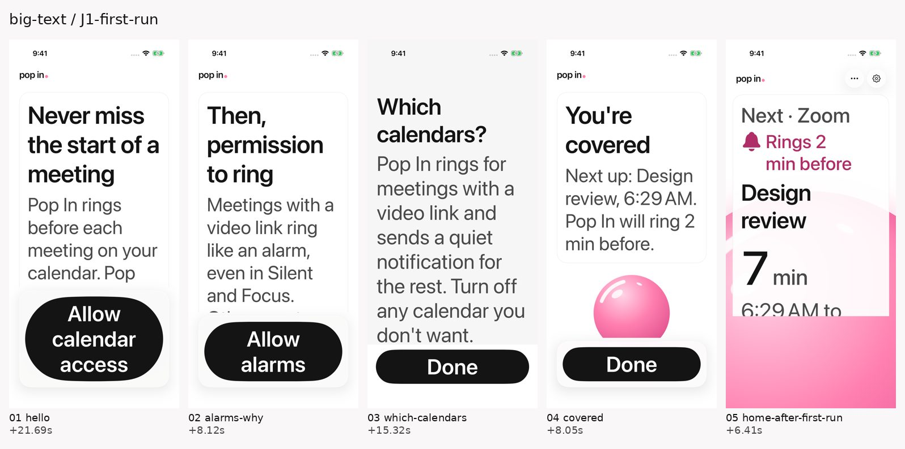
- on screen at hello: buttons ['Allow calendar access']; words ['pop in', 'Never miss the start of a meeting', 'Pop In rings before each meeting on your']
- on screen at which-calendars: buttons ['Exchange, 1 of 1 calendars on', 'Turn all off', 'Work alerts: Smart', 'iCloud, 2 of 2 calendars on', 'Turn all off', 'Family alerts: Smart', 'Home alerts: Smart', 'Done']; words ['Which calendars?', 'Pop In rings for meetings with a video l', 'Exchange', '1 of 1 on', 'Work', 'Smart', 'iCloud', '2 of 2 on', 'Family', 'Smart', 'Home', 'Smart', 'Smart rings full screen for meetings wit']

### big-text / J10-fortune (31 s, 3 checks held, 0 did not)
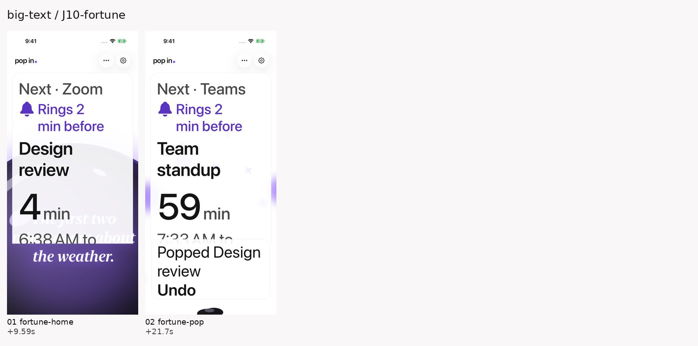
- on screen at fortune-home: buttons ['Pop the bubble to join Design review. Fortune: The first two minutes are about the weather.', 'More', 'Settings', 'Not going']; words ['The first two minutes are about the weat', 'pop in', 'Next · Zoom, Rings 2 min before, Design ', 'Next · Zoom', 'Rings 2 min before', 'Design review', '4, min', '4', 'min', '6:38\u202fAM to 7:08\u202fAM', 'Pop the bubble to join', 'Then 7:33\u202fAM, Team standup', 'Then 7:33\u202fAM', 'Team standup']

### big-text / J11-moon-grenade (49 s, 5 checks held, 0 did not)
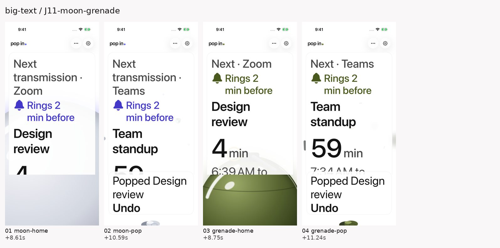

### big-text / J12-all-themes (2086 s, 240 checks held, 0 did not)

### big-text / J13-edge-cases (265 s, 26 checks held, 3 did not)
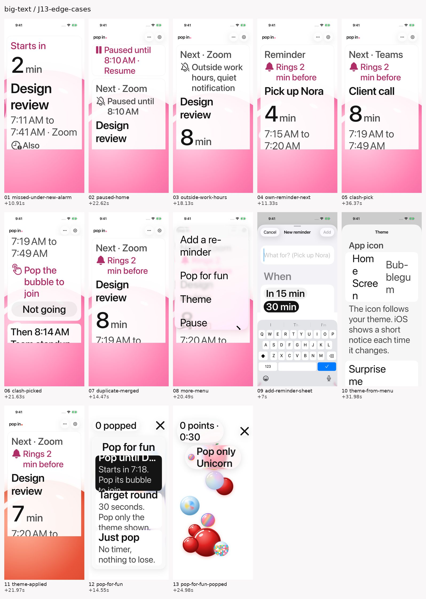

### big-text / J2-home-soon (93 s, 26 checks held, 0 did not)
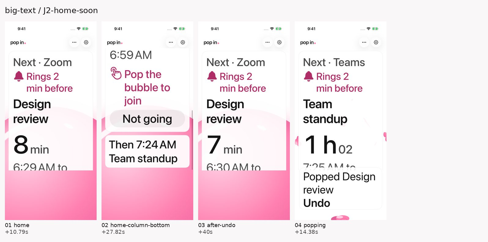
- on screen at home: buttons ['Pop the bubble to join Design review', 'More', 'Settings', 'Not going']; words ['pop in', 'Next · Zoom, Rings 2 min before, Design ', 'Next · Zoom', 'Rings 2 min before', 'Design review', '8, min', '8', 'min', '6:29\u202fAM to 6:59\u202fAM', 'Pop the bubble to join', 'Then 7:24\u202fAM, Team standup', 'Then 7:24\u202fAM', 'Team standup']

### big-text / J3-not-going (46 s, 12 checks held, 0 did not)
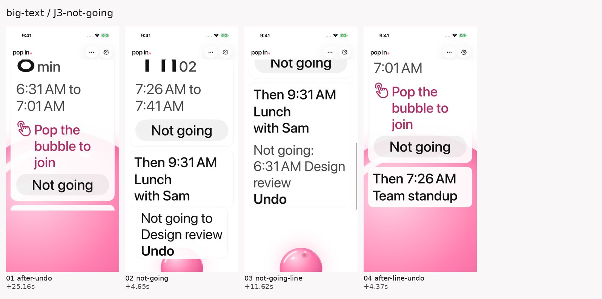

### big-text / J4-home-far (34 s, 6 checks held, 0 did not)
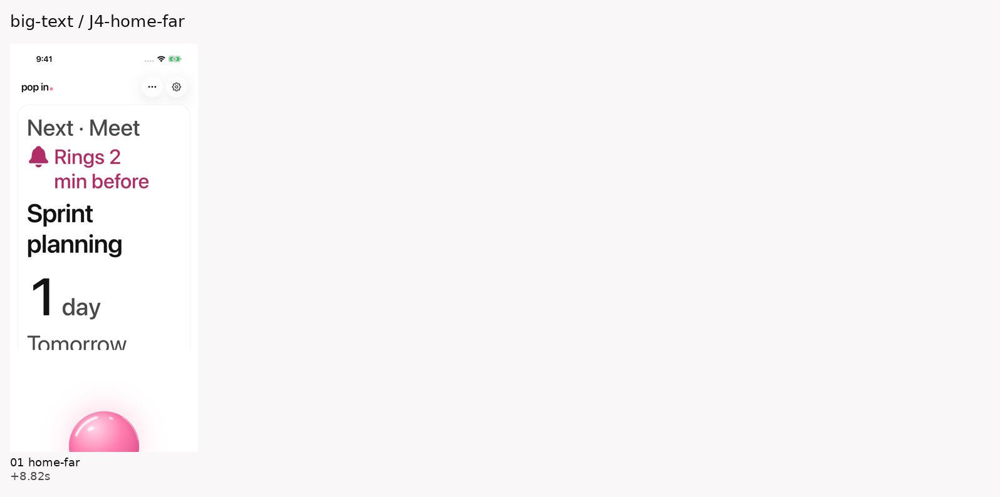
- on screen at home-far: buttons ['Pop the bubble to join Sprint planning', 'More', 'Settings', 'Not going']; words ['pop in', 'Next · Meet, Rings 2 min before, Sprint ', 'Next · Meet', 'Rings 2 min before', 'Sprint planning', '1, day', '1', 'day', 'Tomorrow 9:30\u202fAM to 10:30\u202fAM', 'Then Tomorrow 4:35\u202fPM, Design review', 'Then Tomorrow 4:35\u202fPM', 'Design review']

### big-text / J5-takeover (90 s, 13 checks held, 1 did not)
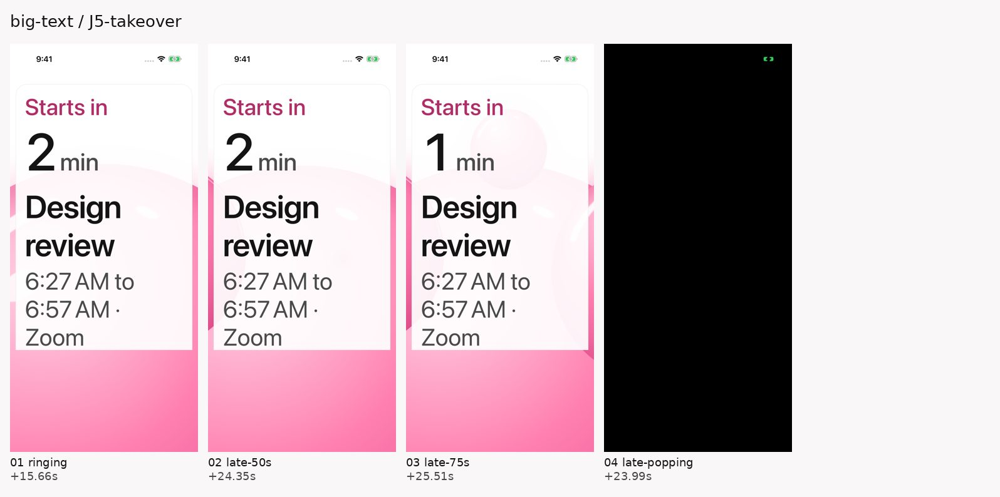
- on screen at ringing: buttons ['Pop the bubble to join Design review', 'Not going', 'Snooze 2 min']; words ['Starts in', 'Starts in 2 min', '2', 'min', 'Design review', '6:27\u202fAM to 6:57\u202fAM · Zoom', 'Pop the bubble to join', 'Snooze 2 min']

### big-text / J6-settings (251 s, 30 checks held, 2 did not)
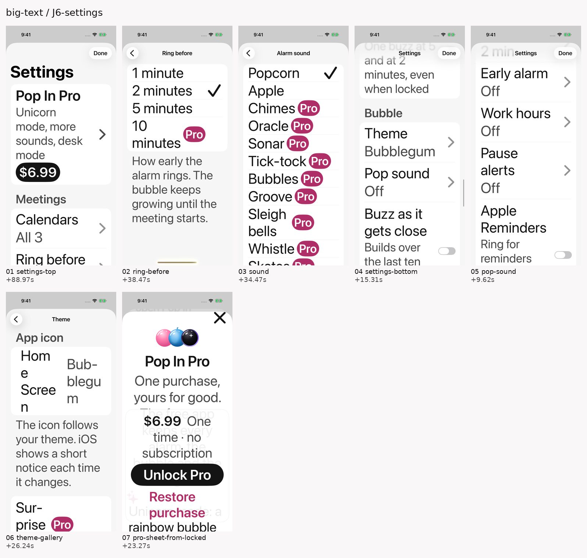
- on screen at settings: buttons ['Done', 'Pop In Pro, Unicorn mode, more sounds, desk mode, $6.99, one-time purchase', 'Calendars, All 3', 'Ring before, 2 min', 'Early alarm, Off', 'Work hours, Off', 'Pause alerts, Off', 'Test the alarm, Rings in 20 seconds, the same way a meeting would', 'Sound, Popcorn', 'Theme, Bubblegum', 'Pop sound, Off', 'Help and support', 'Privacy']; words ['Settings', 'Pop In Pro', 'Unicorn mode, more sounds, desk mode', '$6.99, one-time purchase', 'Meetings', 'Calendars', 'All 3', 'Ring before', '2 min', 'Early alarm', 'Off', 'Work hours', 'Off', 'Pause alerts']
- on screen at settings-bottom: buttons ['Done', 'Pop In Pro, Unicorn mode, more sounds, desk mode, $6.99, one-time purchase', 'Calendars, All 3', 'Ring before, 2 min', 'Early alarm, Off', 'Work hours, Off', 'Pause alerts, Off', 'Test the alarm, Rings in 20 seconds, the same way a meeting would', 'Sound, Popcorn', 'Theme, Bubblegum', 'Pop sound, Off', 'Help and support', 'Privacy']; words ['Settings', 'Pop In Pro', 'Unicorn mode, more sounds, desk mode', '$6.99, one-time purchase', 'Meetings', 'Calendars', 'All 3', 'Ring before', '2 min', 'Early alarm', 'Off', 'Work hours', 'Off', 'Pause alerts']

### big-text / J7-many-calendars (122 s, 18 checks held, 0 did not)
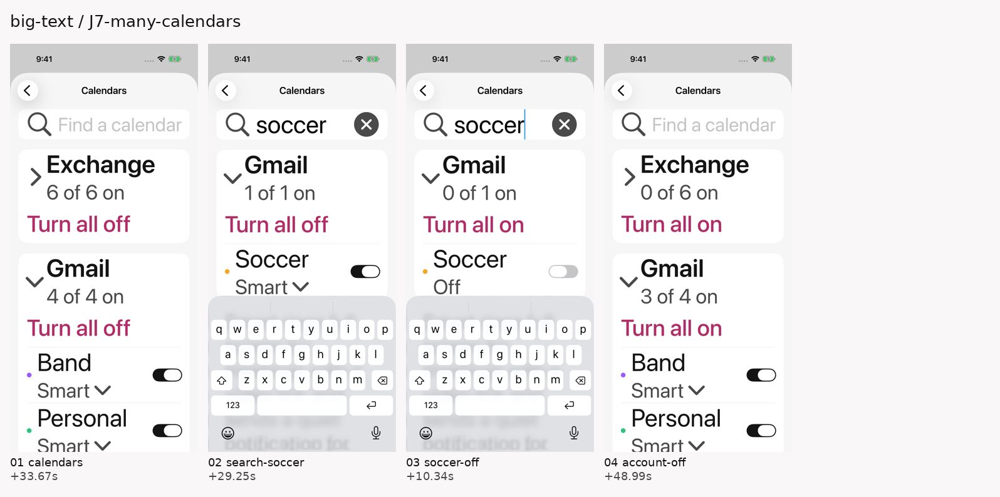
- on screen at calendars: buttons ['Settings', 'Exchange, 6 of 6 calendars on', 'Turn all off', 'Gmail, 4 of 4 calendars on', 'Turn all off', 'Band alerts: Smart', 'Personal alerts: Smart', 'School alerts: Smart', 'Soccer alerts: Smart', 'iCloud, 5 of 5 calendars on', 'Turn all off', 'Anniversaries alerts: Smart', 'Birthdays alerts: Smart', 'Family alerts: Smart']; words ['Calendars', 'Exchange', '6 of 6 on', 'Gmail', '4 of 4 on', 'Band', 'Smart', 'Personal', 'Smart', 'School', 'Smart', 'Soccer', 'Smart', 'iCloud']

### big-text / J8-empty (24 s, 3 checks held, 0 did not)
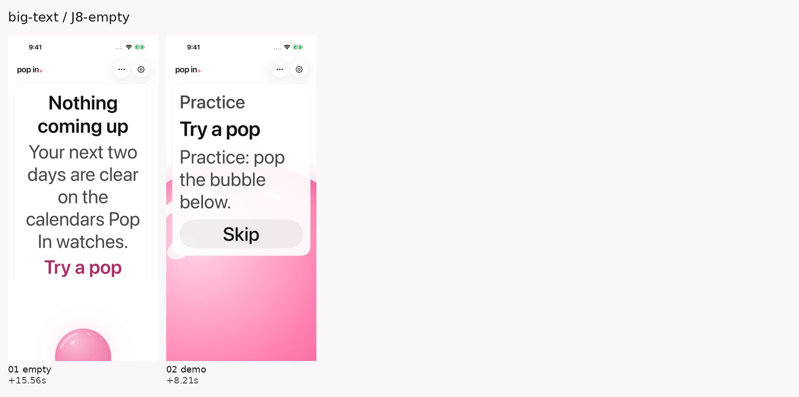
- on screen at empty: buttons ['More', 'Settings', 'Try a pop']; words ['pop in', 'Nothing coming up', 'Your next two days are clear on the cale']
- on screen at demo: buttons ['Pop the bubble to clear Try a pop', 'More', 'Settings', 'Skip']; words ['pop in', 'Practice, Try a pop', 'Practice', 'Try a pop', 'Practice: pop the bubble below.']

### big-text / J9-unicorn (21 s, 2 checks held, 0 did not)
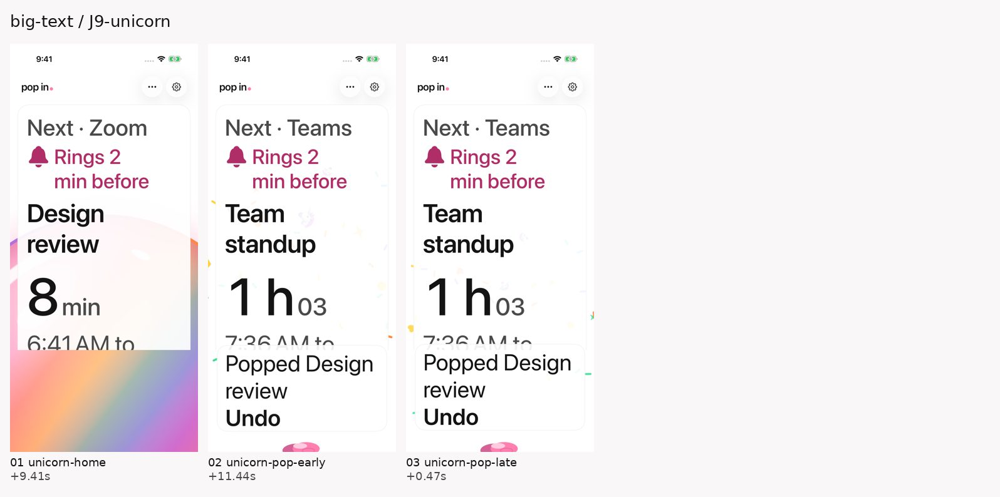

### ipad / J1-first-run (89 s, 13 checks held, 0 did not)
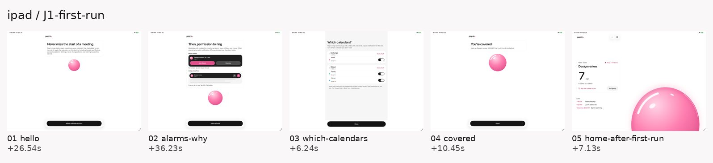
- on screen at hello: buttons ['Allow calendar access']; words ['pop in', 'Never miss the start of a meeting', 'Pop In rings before each meeting on your']
- on screen at which-calendars: buttons ['Exchange, 1 of 1 calendars on', 'Turn all off', 'Work alerts: Smart', 'iCloud, 2 of 2 calendars on', 'Turn all off', 'Family alerts: Smart', 'Home alerts: Smart', 'Done']; words ['Which calendars?', 'Pop In rings for meetings with a video l', 'Exchange', '1 of 1 on', 'Work', 'Smart', 'iCloud', '2 of 2 on', 'Family', 'Smart', 'Home', 'Smart', 'Smart rings full screen for meetings wit']

### ipad / J10-fortune (28 s, 3 checks held, 0 did not)
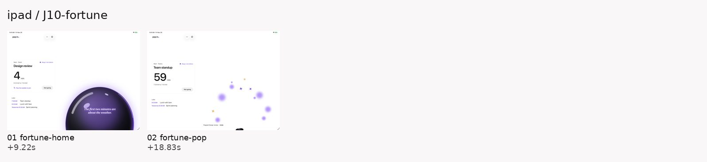
- on screen at fortune-home: buttons ['More', 'Settings', 'Not going', 'Pop the bubble to join Design review. Fortune: The first two minutes are about the weather.']; words ['pop in', 'Next · Zoom, Rings 2 min before, Design ', 'Next · Zoom', 'Rings 2 min before', 'Design review', '4, min', '4', 'min', '6:33\u202fAM to 7:03\u202fAM', 'Pop the bubble to join', 'Later', '7:28\u202fAM', 'Team standup', '9:33\u202fAM']

### ipad / J11-moon-grenade (50 s, 5 checks held, 0 did not)
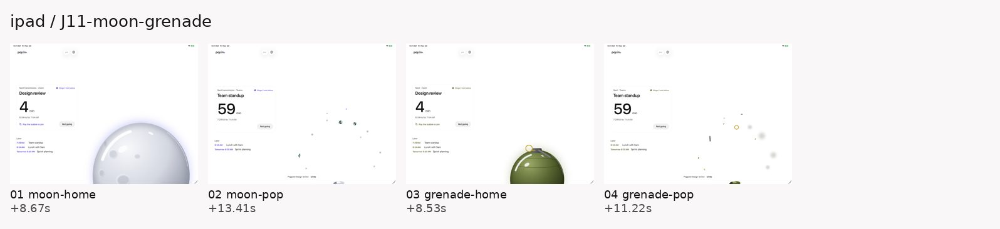

### ipad / J12-all-themes (1803 s, 240 checks held, 0 did not)
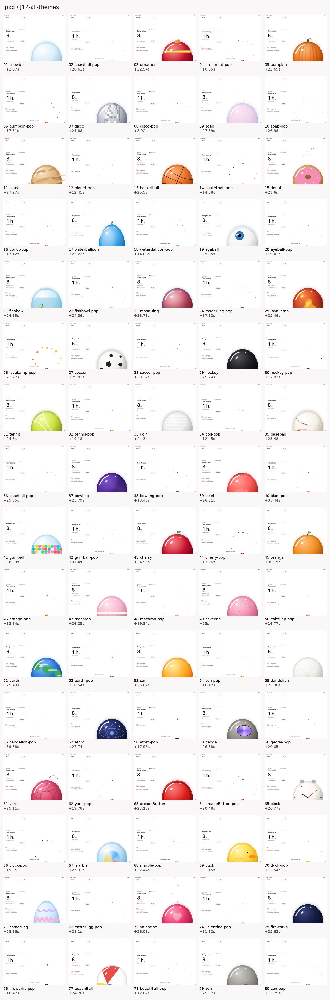

### ipad / J13-edge-cases (294 s, 30 checks held, 1 did not)
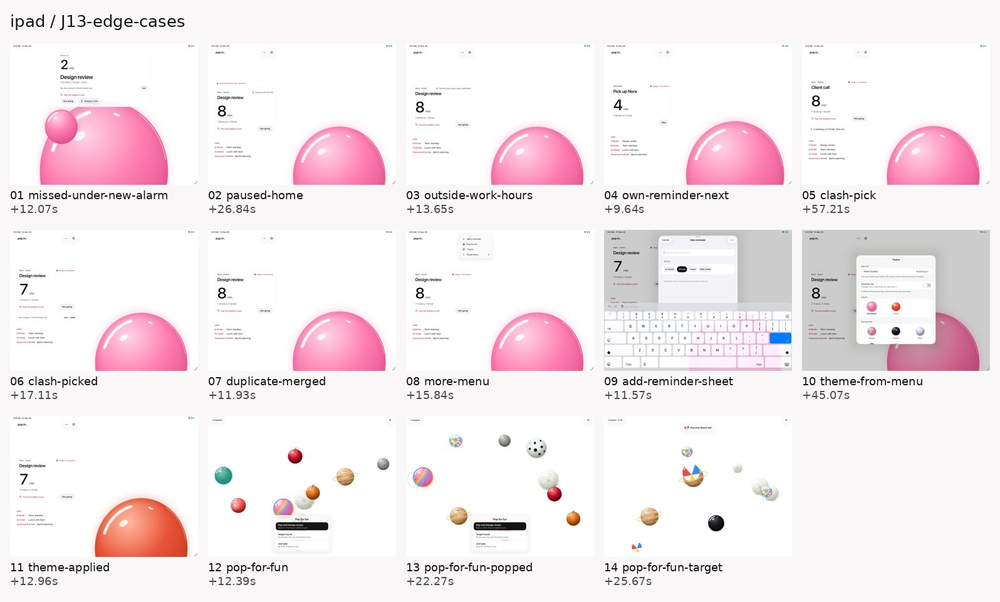

### ipad / J2-home-soon (71 s, 26 checks held, 0 did not)
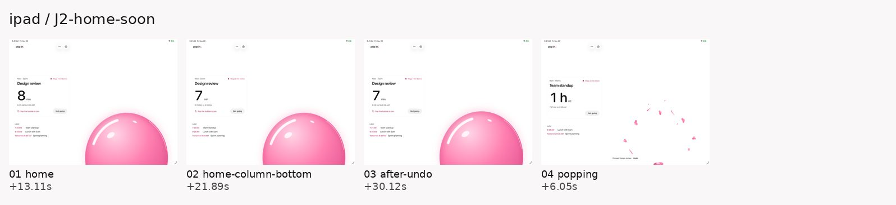
- on screen at home: buttons ['More', 'Settings', 'Not going', 'Pop the bubble to join Design review']; words ['pop in', 'Next · Zoom, Rings 2 min before, Design ', 'Next · Zoom', 'Rings 2 min before', 'Design review', '8, min', '8', 'min', '6:25\u202fAM to 6:55\u202fAM', 'Pop the bubble to join', 'Later', '7:20\u202fAM', 'Team standup', '9:25\u202fAM']

### ipad / J3-not-going (38 s, 12 checks held, 0 did not)
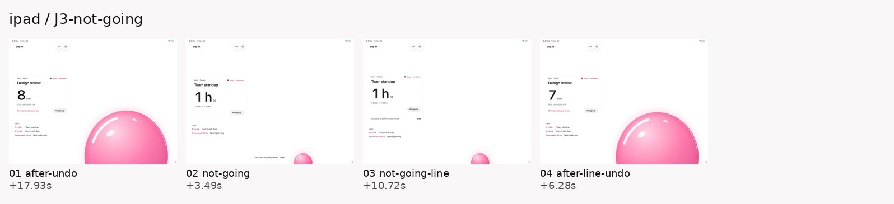

### ipad / J4-home-far (37 s, 7 checks held, 0 did not)
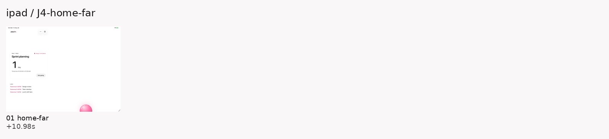
- on screen at home-far: buttons ['More', 'Settings', 'Not going', 'Pop the bubble to join Sprint planning']; words ['pop in', 'Next · Meet, Rings 2 min before, Sprint ', 'Next · Meet', 'Rings 2 min before', 'Sprint planning', '1, day', '1', 'day', 'Tomorrow 9:30\u202fAM to 10:30\u202fAM', 'Later', 'Tomorrow 4:35\u202fPM', 'Design review', 'Tomorrow 5:30\u202fPM', 'Team standup']

### ipad / J5-takeover (73 s, 14 checks held, 0 did not)
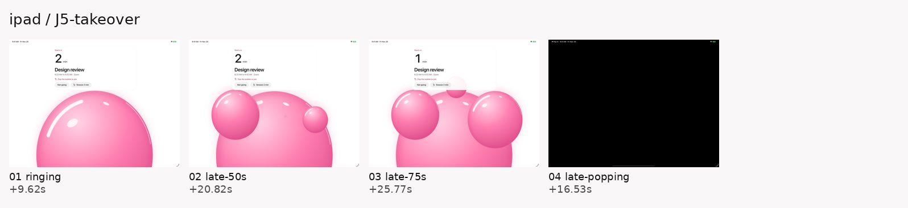
- on screen at ringing: buttons ['Pop the bubble to join Design review', 'Not going', 'Snooze 2 min']; words ['Starts in', 'Starts in 2 min', '2', 'min', 'Design review', '6:22\u202fAM to 6:52\u202fAM · Zoom', 'Pop the bubble to join', 'Snooze 2 min']

### ipad / J6-settings (315 s, 31 checks held, 0 did not)
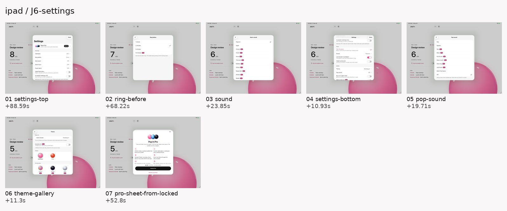
- on screen at settings: buttons ['Done', 'Pop In Pro, Unicorn mode, more sounds, desk mode, $6.99, one-time purchase', 'Calendars, All 3', 'Ring before, 2 min', 'Early alarm, Off', 'Work hours, Off', 'Pause alerts, Off', 'Test the alarm, Rings in 20 seconds, the same way a meeting would', 'Sound, Popcorn', 'Theme, Bubblegum', 'Pop sound, Off', 'Help and support', 'Privacy']; words ['Settings', 'Pop In Pro', 'Unicorn mode, more sounds, desk mode', '$6.99, one-time purchase', 'Meetings', 'Calendars', 'All 3', 'Ring before', '2 min', 'Early alarm', 'Off', 'Work hours', 'Off', 'Pause alerts']
- on screen at settings-bottom: buttons ['Done', 'Pop In Pro, Unicorn mode, more sounds, desk mode, $6.99, one-time purchase', 'Calendars, All 3', 'Ring before, 2 min', 'Early alarm, Off', 'Work hours, Off', 'Pause alerts, Off', 'Test the alarm, Rings in 20 seconds, the same way a meeting would', 'Sound, Popcorn', 'Theme, Bubblegum', 'Pop sound, Off', 'Help and support', 'Privacy']; words ['Settings', 'Pop In Pro', 'Unicorn mode, more sounds, desk mode', '$6.99, one-time purchase', 'Meetings', 'Calendars', 'All 3', 'Ring before', '2 min', 'Early alarm', 'Off', 'Work hours', 'Off', 'Pause alerts']

### ipad / J7-many-calendars (105 s, 18 checks held, 0 did not)
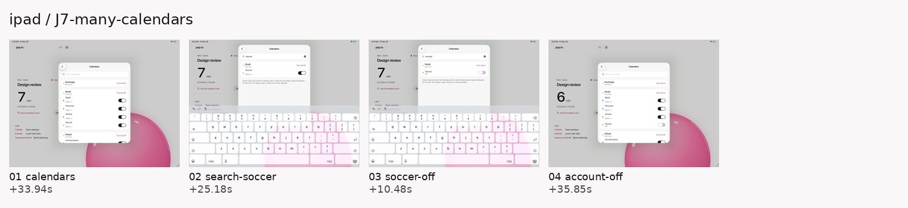
- on screen at calendars: buttons ['Settings', 'Exchange, 6 of 6 calendars on', 'Turn all off', 'Gmail, 4 of 4 calendars on', 'Turn all off', 'Band alerts: Smart', 'Personal alerts: Smart', 'School alerts: Smart', 'Soccer alerts: Smart', 'iCloud, 5 of 5 calendars on', 'Turn all off', 'Anniversaries alerts: Smart', 'Birthdays alerts: Smart', 'Family alerts: Smart']; words ['Calendars', 'Exchange', '6 of 6 on', 'Gmail', '4 of 4 on', 'Band', 'Smart', 'Personal', 'Smart', 'School', 'Smart', 'Soccer', 'Smart', 'iCloud']

### ipad / J8-empty (19 s, 3 checks held, 0 did not)
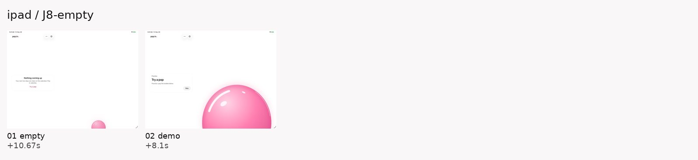
- on screen at empty: buttons ['More', 'Settings', 'Try a pop']; words ['pop in', 'Nothing coming up', 'Your next two days are clear on the cale']
- on screen at demo: buttons ['More', 'Settings', 'Skip', 'Pop the bubble to clear Try a pop']; words ['pop in', 'Practice, Try a pop', 'Practice', 'Try a pop', 'Practice: pop the bubble below.']

### ipad / J9-unicorn (18 s, 2 checks held, 0 did not)
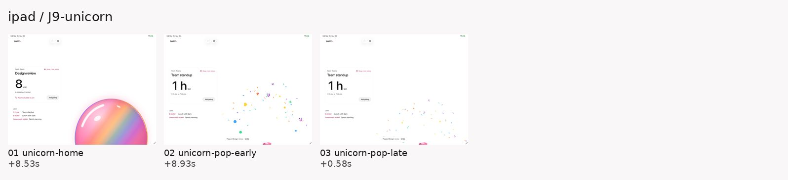

### pro-light / J1-first-run (113 s, 13 checks held, 0 did not)
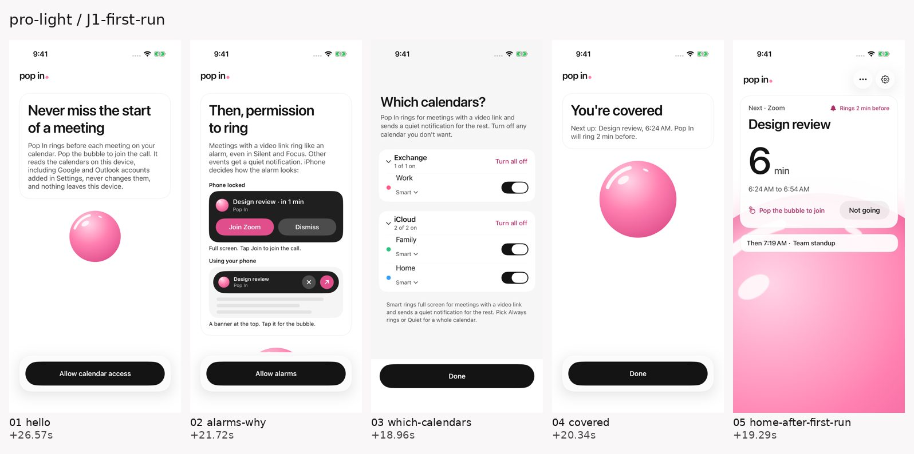
- on screen at hello: buttons ['Allow calendar access']; words ['pop in', 'Never miss the start of a meeting', 'Pop In rings before each meeting on your']
- on screen at which-calendars: buttons ['Exchange, 1 of 1 calendars on', 'Turn all off', 'Work alerts: Smart', 'iCloud, 2 of 2 calendars on', 'Turn all off', 'Family alerts: Smart', 'Home alerts: Smart', 'Done']; words ['Which calendars?', 'Pop In rings for meetings with a video l', 'Exchange', '1 of 1 on', 'Work', 'Smart', 'iCloud', '2 of 2 on', 'Family', 'Smart', 'Home', 'Smart', 'Smart rings full screen for meetings wit']

### pro-light / J10-fortune (27 s, 3 checks held, 0 did not)
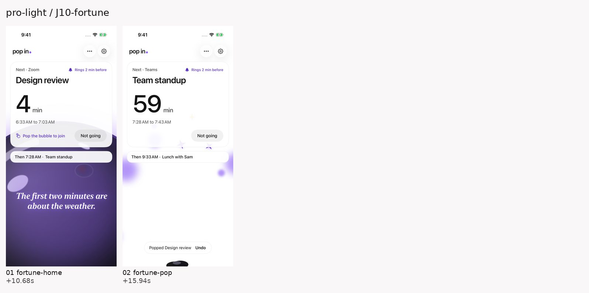
- on screen at fortune-home: buttons ['Pop the bubble to join Design review. Fortune: The first two minutes are about the weather.', 'More', 'Settings', 'Not going']; words ['The first two minutes are about the weat', 'pop in', 'Next · Zoom, Rings 2 min before, Design ', 'Next · Zoom', 'Rings 2 min before', 'Design review', '4, min', '4', 'min', '6:33\u202fAM to 7:03\u202fAM', 'Pop the bubble to join', 'Then 7:28\u202fAM ·, Team standup', 'Then 7:28\u202fAM ·', 'Team standup']

### pro-light / J11-moon-grenade (46 s, 5 checks held, 0 did not)
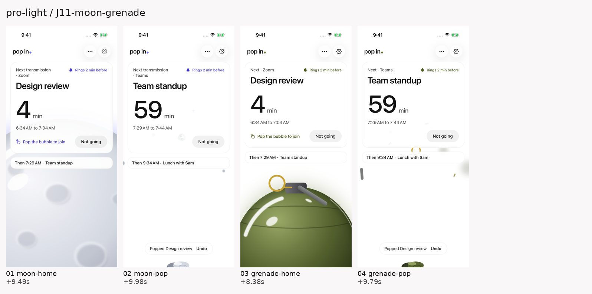

### pro-light / J12-all-themes (1325 s, 240 checks held, 0 did not)

### pro-light / J13-edge-cases (241 s, 30 checks held, 1 did not)
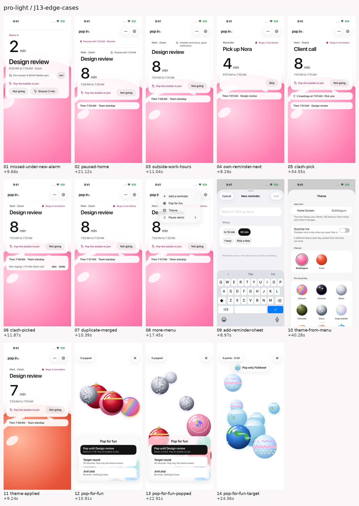

### pro-light / J2-home-soon (79 s, 26 checks held, 0 did not)
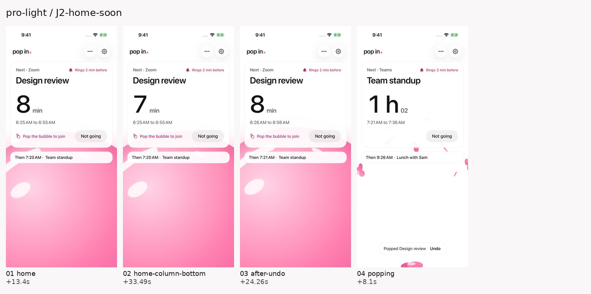
- on screen at home: buttons ['Pop the bubble to join Design review', 'More', 'Settings', 'Not going']; words ['pop in', 'Next · Zoom, Rings 2 min before, Design ', 'Next · Zoom', 'Rings 2 min before', 'Design review', '7, min', '7', 'min', '6:25\u202fAM to 6:55\u202fAM', 'Pop the bubble to join', 'Then 7:20\u202fAM ·, Team standup', 'Then 7:20\u202fAM ·', 'Team standup']

### pro-light / J3-not-going (34 s, 12 checks held, 0 did not)
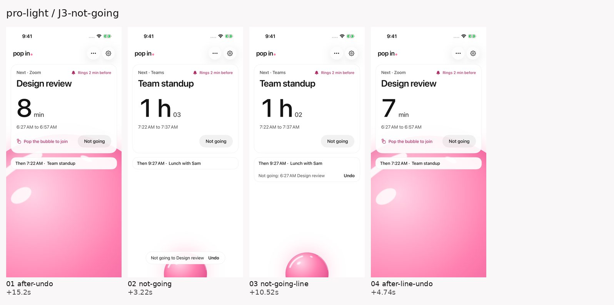

### pro-light / J4-home-far (29 s, 6 checks held, 0 did not)
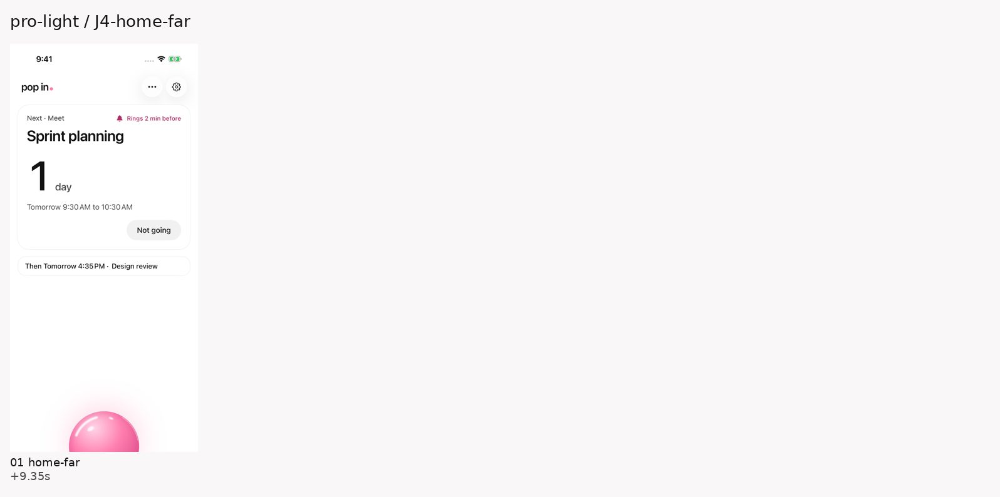
- on screen at home-far: buttons ['Pop the bubble to join Sprint planning', 'More', 'Settings', 'Not going']; words ['pop in', 'Next · Meet, Rings 2 min before, Sprint ', 'Next · Meet', 'Rings 2 min before', 'Sprint planning', '1, day', '1', 'day', 'Tomorrow 9:30\u202fAM to 10:30\u202fAM', 'Then Tomorrow 4:35\u202fPM ·, Design review', 'Then Tomorrow 4:35\u202fPM ·', 'Design review']

### pro-light / J5-takeover (81 s, 13 checks held, 1 did not)
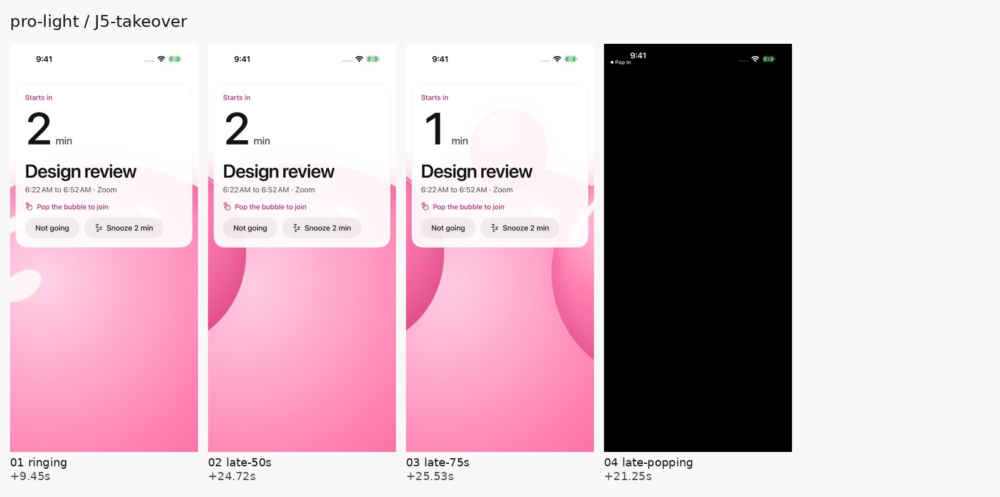
- on screen at ringing: buttons ['Pop the bubble to join Design review', 'Not going', 'Snooze 2 min']; words ['Starts in', 'Starts in 2 min', '2', 'min', 'Design review', '6:22\u202fAM to 6:52\u202fAM · Zoom', 'Pop the bubble to join', 'Snooze 2 min']

### pro-light / J6-settings (301 s, 31 checks held, 0 did not)
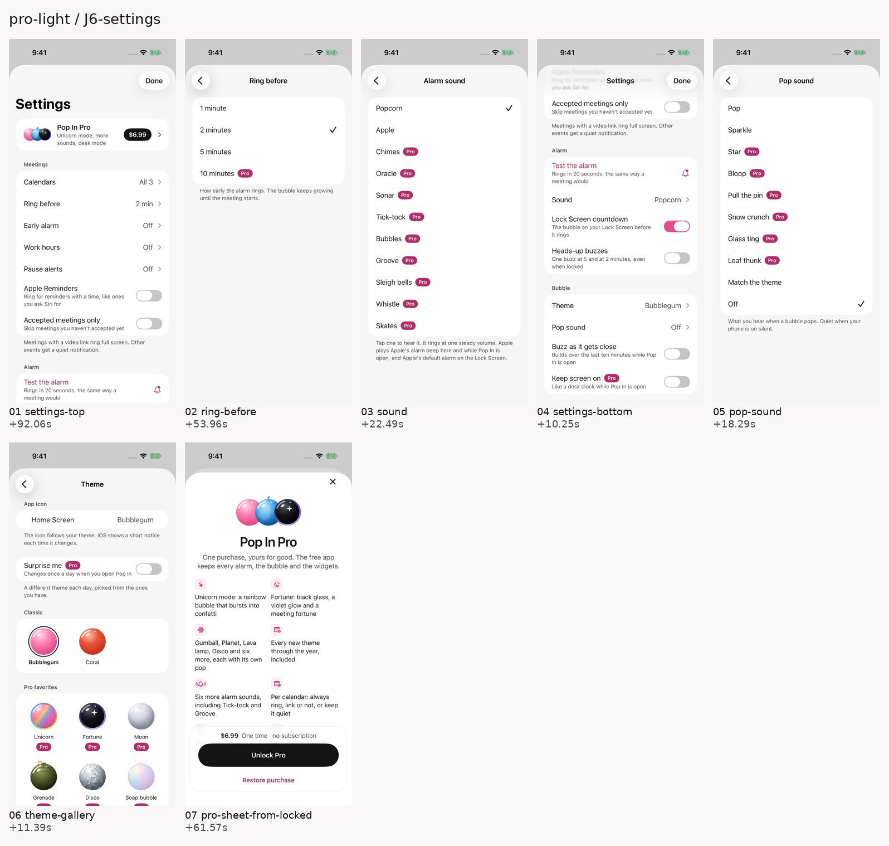
- on screen at settings: buttons ['Done', 'Pop In Pro, Unicorn mode, more sounds, desk mode, $6.99, one-time purchase', 'Calendars, All 3', 'Ring before, 2 min', 'Early alarm, Off', 'Work hours, Off', 'Pause alerts, Off', 'Test the alarm, Rings in 20 seconds, the same way a meeting would', 'Sound, Popcorn', 'Theme, Bubblegum', 'Pop sound, Off', 'Help and support', 'Privacy']; words ['Settings', 'Pop In Pro', 'Unicorn mode, more sounds, desk mode', '$6.99, one-time purchase', 'Meetings', 'Calendars', 'All 3', 'Ring before', '2 min', 'Early alarm', 'Off', 'Work hours', 'Off', 'Pause alerts']
- on screen at settings-bottom: buttons ['Done', 'Pop In Pro, Unicorn mode, more sounds, desk mode, $6.99, one-time purchase', 'Calendars, All 3', 'Ring before, 2 min', 'Early alarm, Off', 'Work hours, Off', 'Pause alerts, Off', 'Test the alarm, Rings in 20 seconds, the same way a meeting would', 'Sound, Popcorn', 'Theme, Bubblegum', 'Pop sound, Off', 'Help and support', 'Privacy']; words ['Settings', 'Pop In Pro', 'Unicorn mode, more sounds, desk mode', '$6.99, one-time purchase', 'Meetings', 'Calendars', 'All 3', 'Ring before', '2 min', 'Early alarm', 'Off', 'Work hours', 'Off', 'Pause alerts']

### pro-light / J7-many-calendars (104 s, 18 checks held, 0 did not)
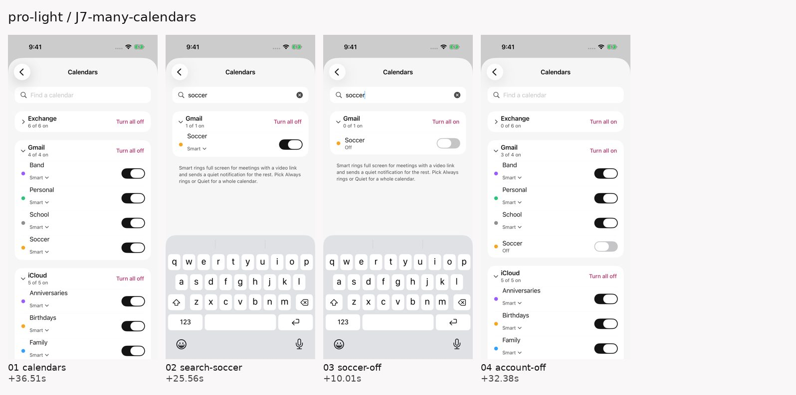
- on screen at calendars: buttons ['Settings', 'Exchange, 6 of 6 calendars on', 'Turn all off', 'Gmail, 4 of 4 calendars on', 'Turn all off', 'Band alerts: Smart', 'Personal alerts: Smart', 'School alerts: Smart', 'Soccer alerts: Smart', 'iCloud, 5 of 5 calendars on', 'Turn all off', 'Anniversaries alerts: Smart', 'Birthdays alerts: Smart', 'Family alerts: Smart']; words ['Calendars', 'Exchange', '6 of 6 on', 'Gmail', '4 of 4 on', 'Band', 'Smart', 'Personal', 'Smart', 'School', 'Smart', 'Soccer', 'Smart', 'iCloud']

### pro-light / J8-empty (20 s, 3 checks held, 0 did not)
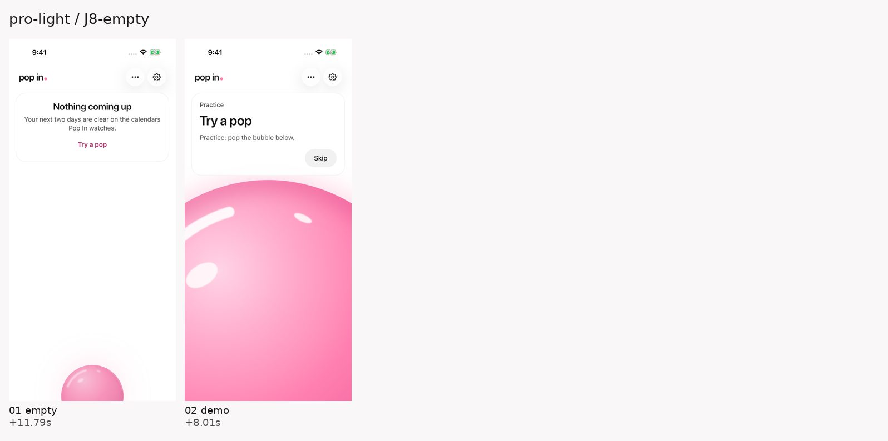
- on screen at empty: buttons ['More', 'Settings', 'Try a pop']; words ['pop in', 'Nothing coming up', 'Your next two days are clear on the cale']
- on screen at demo: buttons ['Pop the bubble to clear Try a pop', 'More', 'Settings', 'Skip']; words ['pop in', 'Practice, Try a pop', 'Practice', 'Try a pop', 'Practice: pop the bubble below.']

### pro-light / J9-unicorn (20 s, 2 checks held, 0 did not)
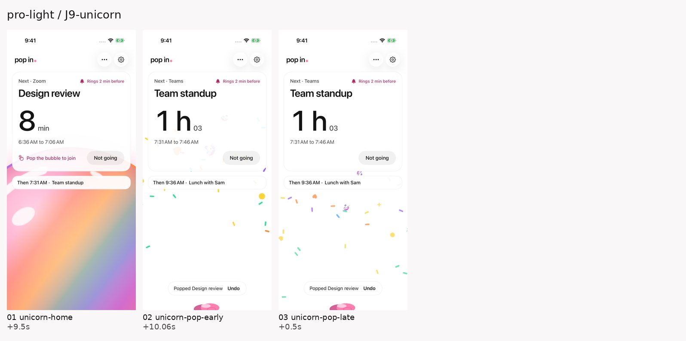

### small-phone / J1-first-run (139 s, 13 checks held, 0 did not)
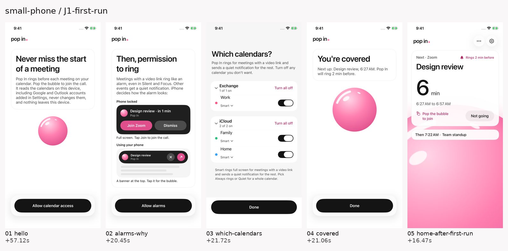
- on screen at hello: buttons ['Allow calendar access']; words ['pop in', 'Never miss the start of a meeting', 'Pop In rings before each meeting on your']
- on screen at which-calendars: buttons ['Exchange, 1 of 1 calendars on', 'Turn all off', 'Work alerts: Smart', 'iCloud, 2 of 2 calendars on', 'Turn all off', 'Family alerts: Smart', 'Home alerts: Smart', 'Done']; words ['Which calendars?', 'Pop In rings for meetings with a video l', 'Exchange', '1 of 1 on', 'Work', 'Smart', 'iCloud', '2 of 2 on', 'Family', 'Smart', 'Home', 'Smart', 'Smart rings full screen for meetings wit']

### small-phone / J10-fortune (18 s, 3 checks held, 0 did not)

- on screen at fortune-home: buttons ['Pop the bubble to join Design review. Fortune: The first two minutes are about the weather.', 'More', 'Settings', 'Not going']; words ['The first two minutes are about the weat', 'pop in', 'Next · Zoom, Rings 2 min before, Design ', 'Next · Zoom', 'Rings 2 min before', 'Design review', '4, min', '4', 'min', '6:34\u202fAM to 7:04\u202fAM', 'Pop the bubble to join', 'Then 7:29\u202fAM ·, Team standup', 'Then 7:29\u202fAM ·', 'Team standup']

### small-phone / J11-moon-grenade (39 s, 5 checks held, 0 did not)
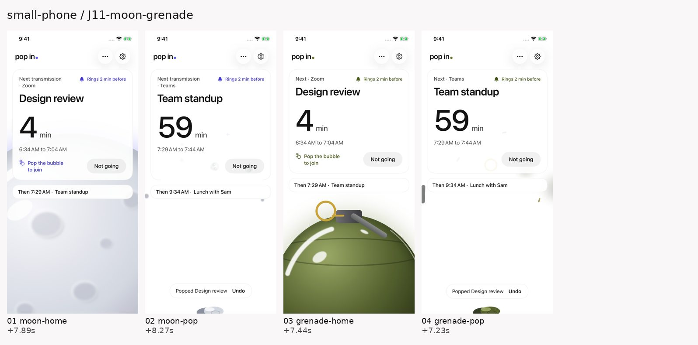

### small-phone / J12-all-themes (1199 s, 240 checks held, 0 did not)

### small-phone / J13-edge-cases (194 s, 29 checks held, 2 did not)
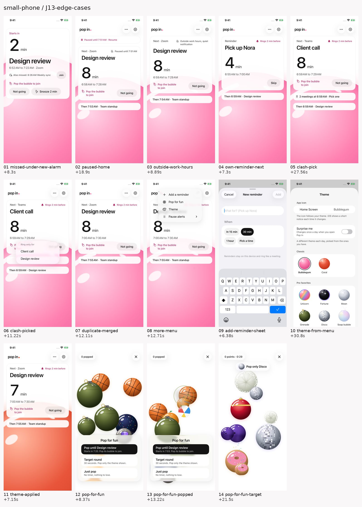

### small-phone / J2-home-soon (70 s, 26 checks held, 0 did not)
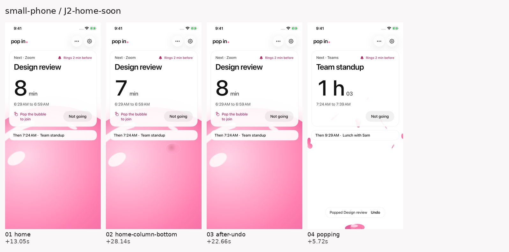
- on screen at home: buttons ['Pop the bubble to join Design review', 'More', 'Settings', 'Not going']; words ['pop in', 'Next · Zoom, Rings 2 min before, Design ', 'Next · Zoom', 'Rings 2 min before', 'Design review', '8, min', '8', 'min', '6:29\u202fAM to 6:59\u202fAM', 'Pop the bubble to join', 'Then 7:24\u202fAM ·, Team standup', 'Then 7:24\u202fAM ·', 'Team standup']

### small-phone / J3-not-going (32 s, 12 checks held, 0 did not)
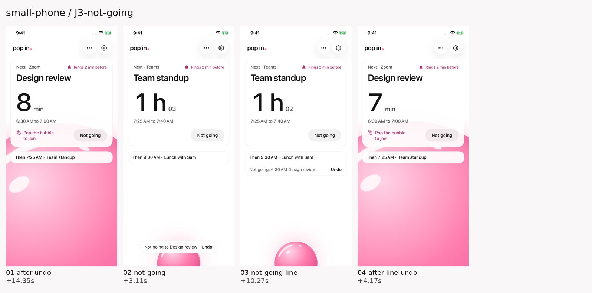

### small-phone / J4-home-far (28 s, 6 checks held, 0 did not)
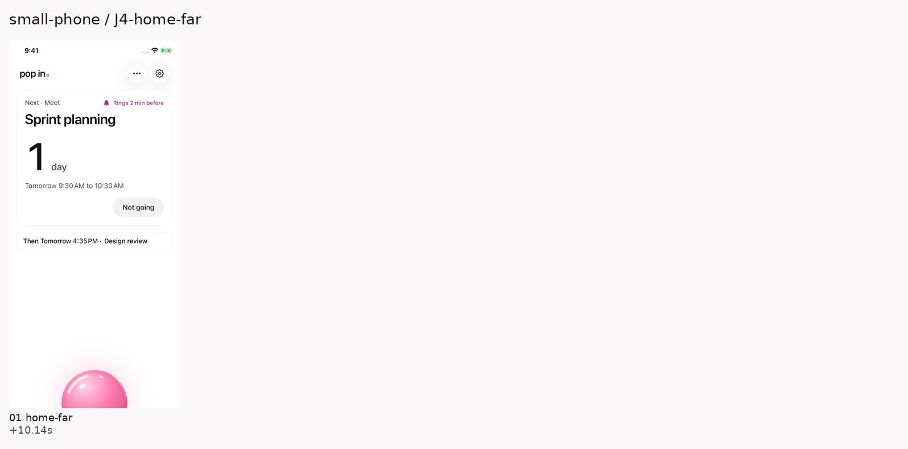
- on screen at home-far: buttons ['Pop the bubble to join Sprint planning', 'More', 'Settings', 'Not going']; words ['pop in', 'Next · Meet, Rings 2 min before, Sprint ', 'Next · Meet', 'Rings 2 min before', 'Sprint planning', '1, day', '1', 'day', 'Tomorrow 9:30\u202fAM to 10:30\u202fAM', 'Then Tomorrow 4:35\u202fPM ·, Design review', 'Then Tomorrow 4:35\u202fPM ·', 'Design review']

### small-phone / J5-takeover (63 s, 14 checks held, 0 did not)
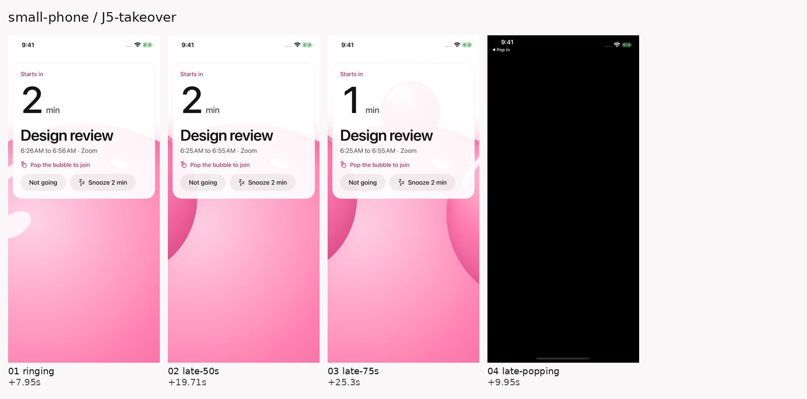
- on screen at ringing: buttons ['Pop the bubble to join Design review', 'Not going', 'Snooze 2 min']; words ['Starts in', 'Starts in 2 min', '2', 'min', 'Design review', '6:26\u202fAM to 6:56\u202fAM · Zoom', 'Pop the bubble to join', 'Snooze 2 min']

### small-phone / J6-settings (188 s, 31 checks held, 0 did not)
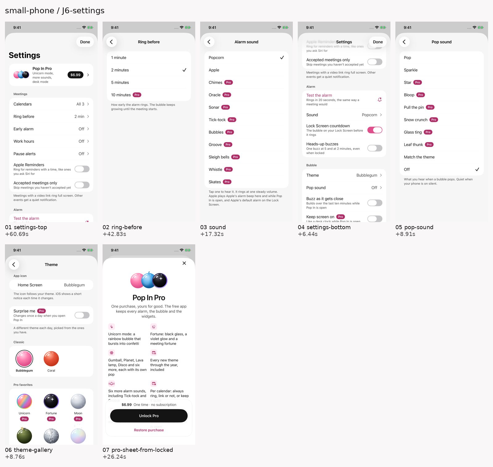
- on screen at settings: buttons ['Done', 'Pop In Pro, Unicorn mode, more sounds, desk mode, $6.99, one-time purchase', 'Calendars, All 3', 'Ring before, 2 min', 'Early alarm, Off', 'Work hours, Off', 'Pause alerts, Off', 'Test the alarm, Rings in 20 seconds, the same way a meeting would', 'Sound, Popcorn', 'Theme, Bubblegum', 'Pop sound, Off', 'Help and support', 'Privacy']; words ['Settings', 'Pop In Pro', 'Unicorn mode, more sounds, desk mode', '$6.99, one-time purchase', 'Meetings', 'Calendars', 'All 3', 'Ring before', '2 min', 'Early alarm', 'Off', 'Work hours', 'Off', 'Pause alerts']
- on screen at settings-bottom: buttons ['Done', 'Pop In Pro, Unicorn mode, more sounds, desk mode, $6.99, one-time purchase', 'Calendars, All 3', 'Ring before, 2 min', 'Early alarm, Off', 'Work hours, Off', 'Pause alerts, Off', 'Test the alarm, Rings in 20 seconds, the same way a meeting would', 'Sound, Popcorn', 'Theme, Bubblegum', 'Pop sound, Off', 'Help and support', 'Privacy']; words ['Settings', 'Pop In Pro', 'Unicorn mode, more sounds, desk mode', '$6.99, one-time purchase', 'Meetings', 'Calendars', 'All 3', 'Ring before', '2 min', 'Early alarm', 'Off', 'Work hours', 'Off', 'Pause alerts']

### small-phone / J7-many-calendars (88 s, 18 checks held, 0 did not)
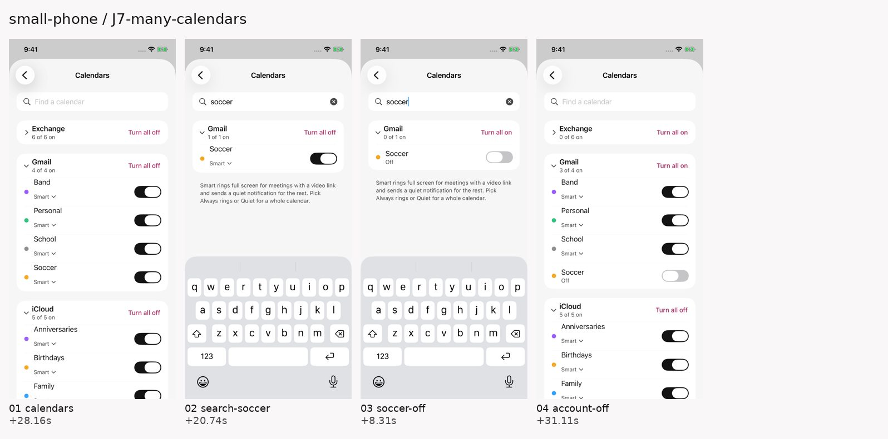
- on screen at calendars: buttons ['Settings', 'Exchange, 6 of 6 calendars on', 'Turn all off', 'Gmail, 4 of 4 calendars on', 'Turn all off', 'Band alerts: Smart', 'Personal alerts: Smart', 'School alerts: Smart', 'Soccer alerts: Smart', 'iCloud, 5 of 5 calendars on', 'Turn all off', 'Anniversaries alerts: Smart', 'Birthdays alerts: Smart', 'Family alerts: Smart']; words ['Calendars', 'Exchange', '6 of 6 on', 'Gmail', '4 of 4 on', 'Band', 'Smart', 'Personal', 'Smart', 'School', 'Smart', 'Soccer', 'Smart', 'iCloud']

### small-phone / J8-empty (19 s, 3 checks held, 0 did not)
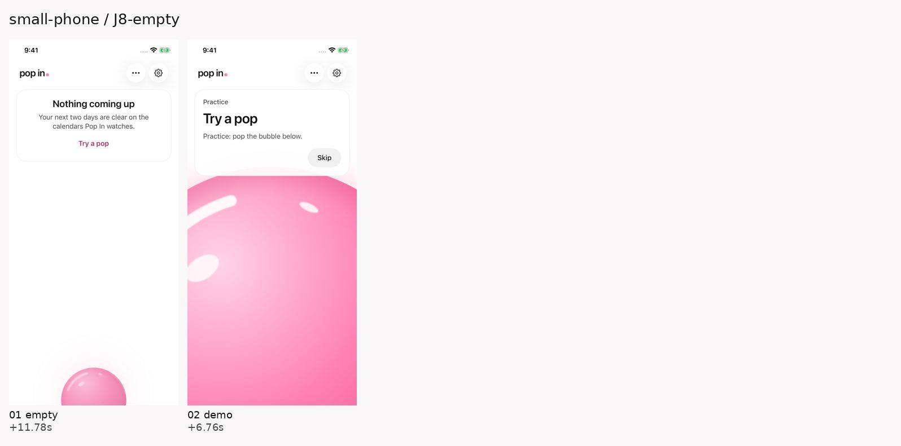
- on screen at empty: buttons ['More', 'Settings', 'Try a pop']; words ['pop in', 'Nothing coming up', 'Your next two days are clear on the cale']
- on screen at demo: buttons ['Pop the bubble to clear Try a pop', 'More', 'Settings', 'Skip']; words ['pop in', 'Practice, Try a pop', 'Practice', 'Try a pop', 'Practice: pop the bubble below.']

### small-phone / J9-unicorn (16 s, 2 checks held, 0 did not)

